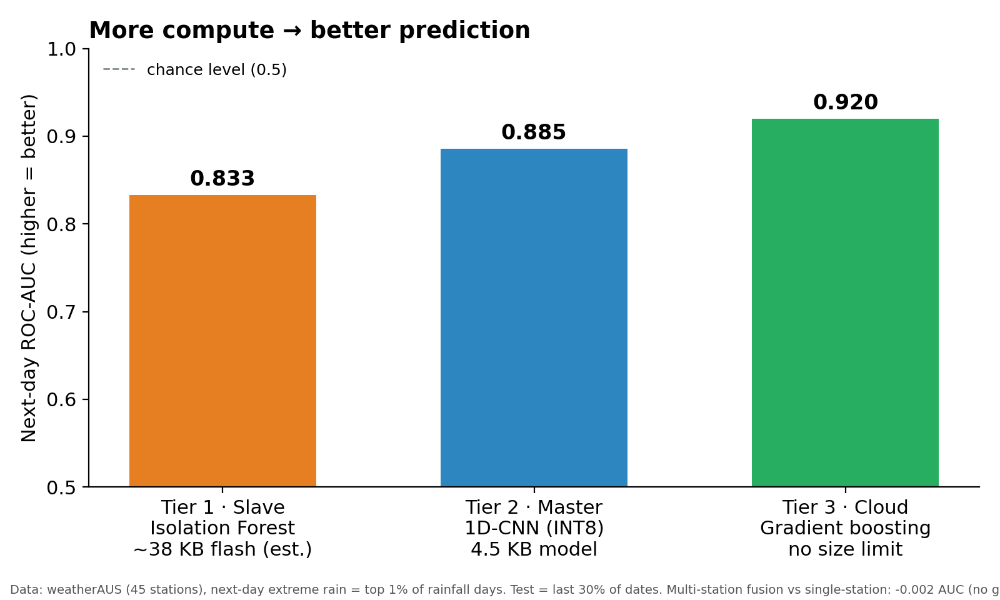
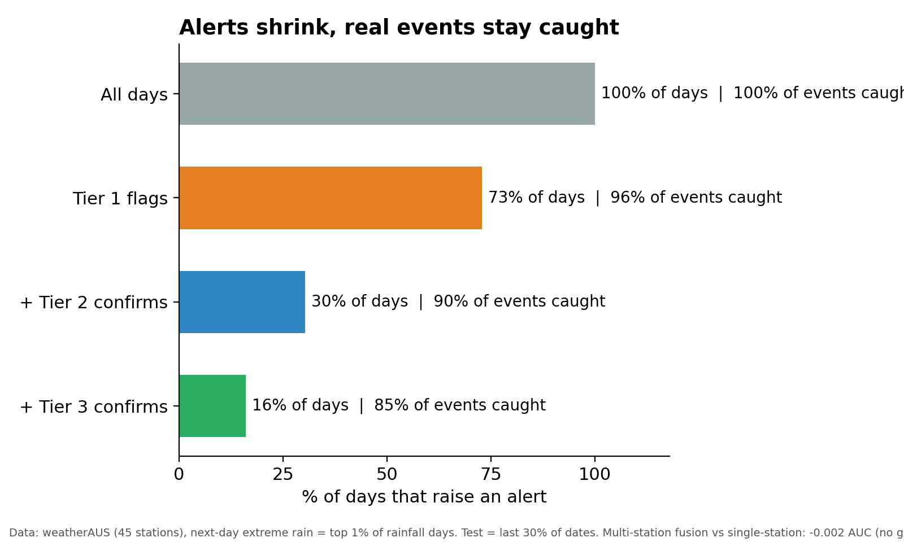
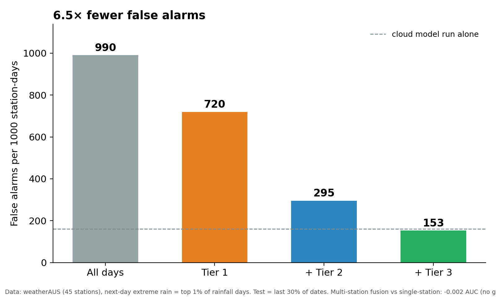
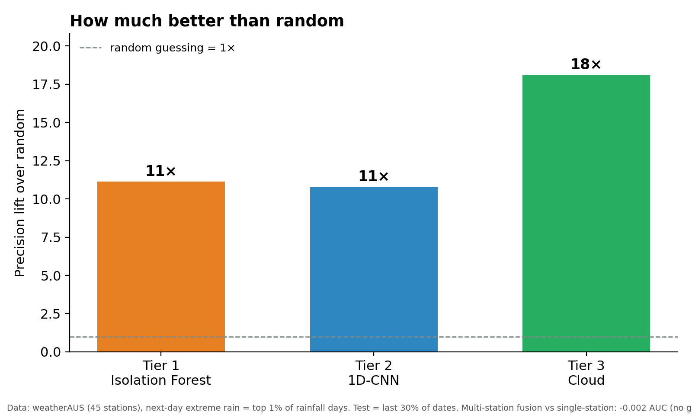
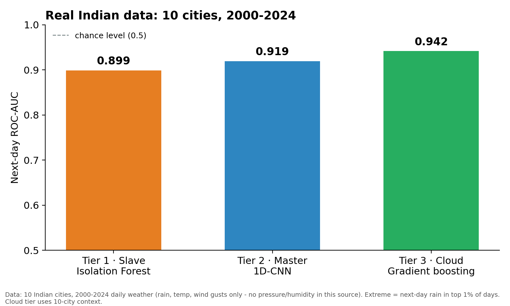
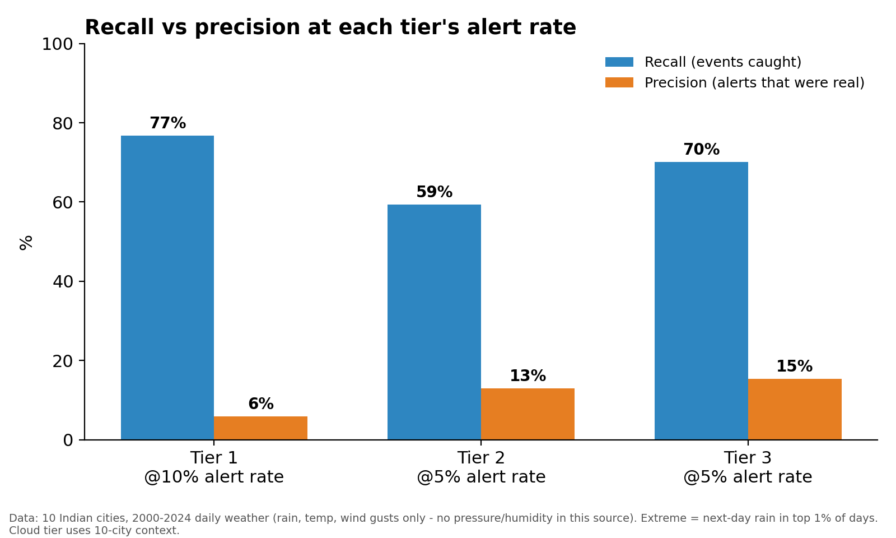
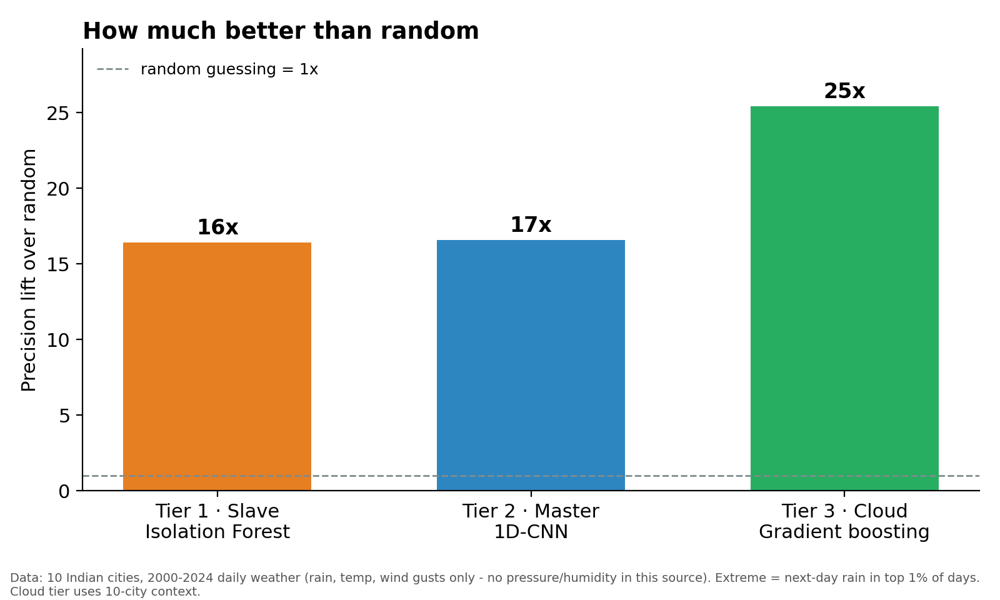

# FloodSense — TinyML-to-Cloud Disaster Alerting

**SIH 2026 prototype.** A three-tier machine learning pipeline for early flood/extreme-rain warning: a solar-powered edge sensor filters noise for free, a local gateway confirms the risk, and the cloud makes the final call. This document is a measured benchmark of that pipeline, run before the hardware existed, on two independent real-world datasets.

> All numbers below are measured on held-out test data (the model never saw these dates during training). Where a number is an estimate rather than a measurement, it's labeled as such.

## 1. The architecture

| Tier | Where it runs | Model | Job |
|---|---|---|---|
| **Tier 1 — Slave node** | Solar-powered MCU (ESP32/STM32) | Isolation Forest | Cheap, always-on anomaly filter. Wakes the radio only when something looks off. |
| **Tier 2 — Master node** | ESP32-S3 gateway | 1D-CNN (INT8) | Looks at the last several days of readings to confirm a real building trend, not noise. |
| **Tier 3 — Cloud** | AWS | Gradient boosting → (planned) spatio-temporal GNN | No hardware limits. Combines every node's data for the final, highest-confidence call. |

The point of the cascade: each tier only has to say yes for an alert to move up, and each tier is cheap enough to run continuously on its own hardware. Most days never leave the sensor node.

## 2. Benchmark 1 — weatherAUS (validates the full sensor set)

**Why this dataset:** it's the only common public dataset with all four of our planned sensors — rainfall, pressure, temperature, humidity — logged daily across many stations for 10 years. Used to prove the architecture and the pressure-gradient feature work end to end.

- **125,732 station-days**, 10 years, many Australian weather stations.
- **Task:** predict whether *tomorrow* will be an extreme-rain day (top 1% of rainfall, ≥37.2 mm), from today's rainfall, 3-day rainfall, pressure change, temperature and humidity.
- **Split by time:** train on the first 70% of dates, test on the last 30% — the model never sees the future.

| Tier | Next-day ROC-AUC | Model size |
|---|---|---|
| Tier 1: Isolation Forest | 0.833 | 5,496 nodes, ~38 KB flash (estimate) |
| Tier 2: 1D-CNN, INT8 | 0.885–0.890 | 209 parameters, 4.5 KB |
| Tier 3: Gradient boosting | 0.920–0.922 | no hardware limit |



**ROC-AUC**, in one line: the probability the model ranks a real extreme-rain day above a normal day. 0.5 is a coin flip, 1.0 is perfect.

### The cascade: fewer alerts, most events still caught

Chaining the three tiers (each confirms what the previous one flagged) was tested with thresholds set on a separate validation period, then measured on unseen test data:

| Stage | % of days flagged | % of extreme-rain days still caught |
|---|---|---|
| No filter | 100% | 100% |
| Tier 1 flags | 73% | 96% |
| + Tier 2 confirms | 30% | 90% |
| + Tier 3 confirms | 16% | **85%** |





**Result: false alarms drop 6.5× (990 → 153 per 1,000 station-days) while still catching 85% of extreme-rain days, and only 16% of days ever need the radio or the cloud.** This is a bandwidth/battery win, not an accuracy win — running the cloud model on every single day gives about the same false-alarm rate. The edge tiers exist to make that accuracy affordable on solar power, not to beat the cloud model.



### Multi-station fusion — tested honestly

We also tested whether a station benefits from seeing what *other* stations are reporting the same day (a stand-in for the planned graph neural network). On weatherAUS, across 45 stations spread over a continent, it did not help (single-station AUC 0.922 vs multi-station 0.920 — no gain). We're not claiming a fusion benefit from this test; the real case for it is terrain and river-flow data this dataset doesn't have, and stations that are close together in one basin, not scattered across a country.

## 3. Benchmark 2 — Indian weather, 10 cities, 2000–2024

**Why a second dataset:** to validate the pipeline on real Indian conditions specifically, not just prove the architecture in the abstract.

- **91,310 city-days**, 25 years, 10 major Indian cities (Delhi, Mumbai, Bangalore, Chennai, Kolkata, Hyderabad, Ahmedabad, Pune, Jaipur, Lucknow).
- **Important caveat:** this source has no pressure or humidity columns, unlike our planned BME280 sensor. Features used instead: rainfall, 3-day rainfall, max/min temperature, and wind gusts. Extreme rain here is ≥41.3 mm (top 1% of days in this dataset).

| Tier | Next-day ROC-AUC | Recall / Precision at its alert rate |
|---|---|---|
| Tier 1: Isolation Forest | 0.899 | 76.7% / 5.9% @ 10% alerts |
| Tier 2: 1D-CNN | 0.919 | 59.4% / 13.0% @ 5% alerts |
| Tier 3: Gradient boosting (10-city context) | 0.942 | 70.1% / 15.4% @ 5% alerts |





**Takeaway:** even without pressure and humidity, all three tiers clear 0.89+ AUC on real Indian rainfall across a decade and a half. This is *consistent with* the weatherAUS result, not a stronger or weaker version of it — the datasets, thresholds and feature sets differ, so the numbers aren't directly comparable. Adding pressure and humidity in the field, as our actual sensor suite will, should only help further.

## 4. What every number in this repo actually means

- **"Next-day extreme rain"** is a proxy label (top 1% rainfall days), not a real flood event. It proves the pipeline predicts a hazardous-weather signal; ground-truth flood labels would need to come from CWC/IMD or field deployment.
- **Latency numbers on the ESP32-S3 are estimates**, not hardware measurements (we don't have the boards yet). Laptop CPU timings are reported separately and are clearly not MCU numbers.
- **The Isolation Forest was exported to a C header** (`if_model.h`) and its output was checked against scikit-learn's, matching to within 1.5×10⁻⁷ — so the exported model is verified, even though it hasn't run on real silicon yet.
- **Precision is low by design** (5–15%), because extreme days are ~1% of all days and this is a safety system: we accept false alarms so the recall stays high, and rely on the tiers above to filter them out.

## 5. How to reproduce

```bash
pip install numpy pandas scikit-learn tensorflow matplotlib

# Tier 1+2+3 benchmark on weatherAUS
python sih_tinyml_benchmark.py --csv weatherAUS.csv

# Full alert-cascade funnel (needs sih_tinyml_benchmark.py in the same folder)
python cascade_demo.py --csv weatherAUS.csv

# CNN filter-size sweep (justifies the 8-filter choice)
python filter_sweep.py --csv weatherAUS.csv

# Second benchmark on real Indian data
python india_benchmark.py --csv india_2000_2024_daily_weather.csv

# Regenerate every chart in this README
python make_visuals.py
python make_visuals_india.py
```

Datasets (not included in this repo — download separately):
- [Rain in Australia (weatherAUS)](https://www.kaggle.com/datasets/jsphyg/weather-dataset-rattle-package) — Kaggle
- [India Daily Weather 2000–2024, 10 Major Cities](https://www.kaggle.com/datasets/developerghost/climate-in-india-daily-weather-data-2000-2024) — Kaggle

## 6. What's not yet built

- No hardware-in-the-loop testing (ESP32/STM32 latency and power are estimates).
- No real flood ground truth — extreme rainfall is a proxy.
- The spatio-temporal GNN is a planned cloud-tier upgrade over the gradient-boosting model benchmarked here; it hasn't been built or tested.
- Multi-node fusion is unproven on real, closely-spaced sensor data — only tested on continent-spread weather stations, where it showed no benefit.